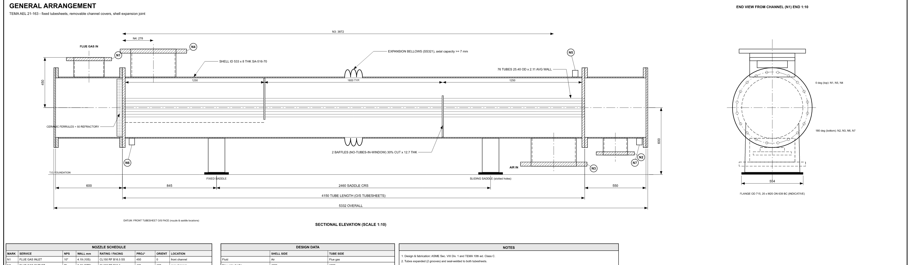
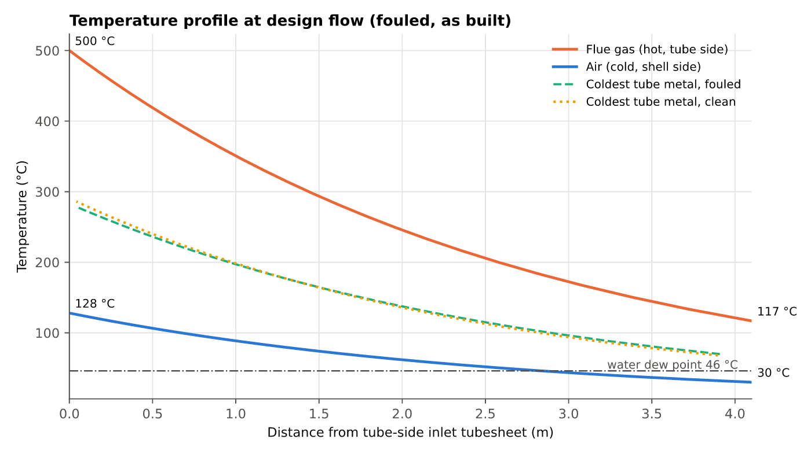
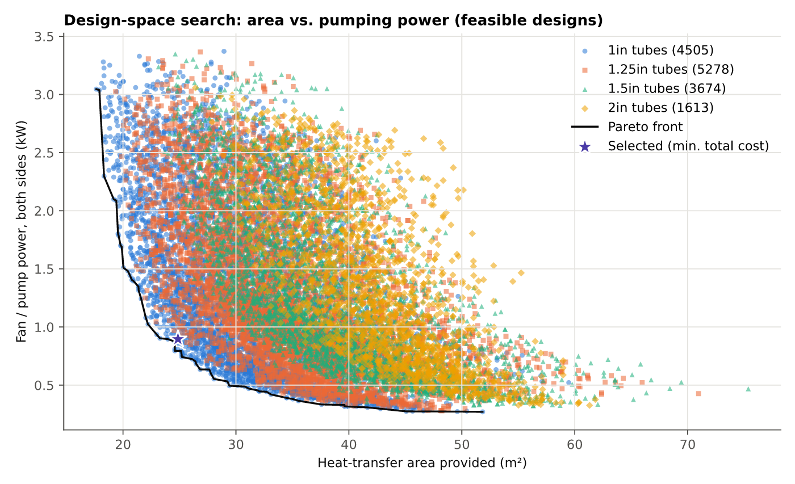
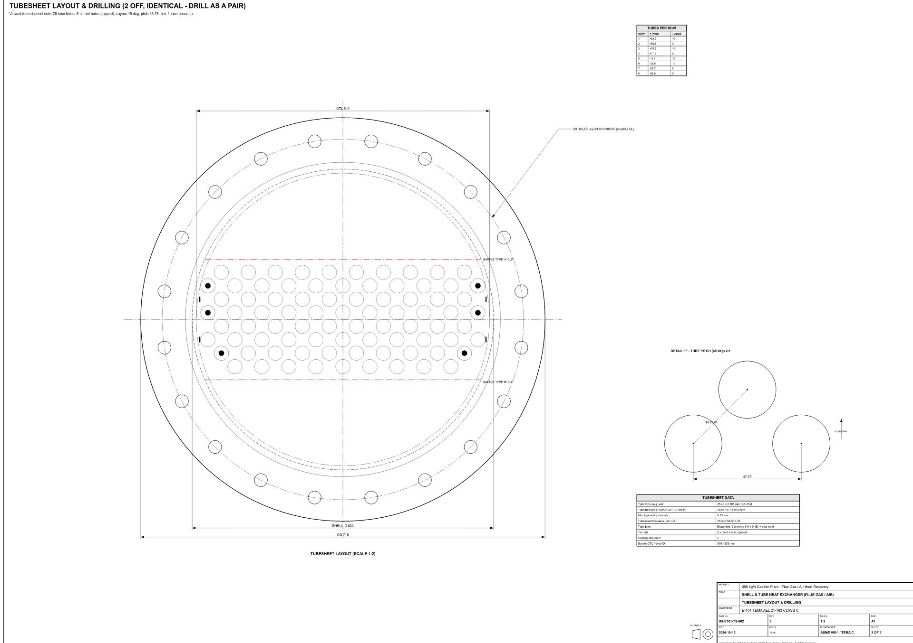

# shell-tube-hx-design — a Claude skill for shell-and-tube heat exchanger design

A [Claude Agent Skill](https://docs.claude.com/en/docs/agents-and-tools/agent-skills/overview) that designs, sizes, optimises and rates single-phase **shell-and-tube heat exchangers (TEMA)**. It uses the open-source Python libraries [`ht`](https://pypi.org/project/ht/), [`fluids`](https://pypi.org/project/fluids/) and [`thermo`](https://pypi.org/project/thermo/). It produces **fabrication-oriented TEMA drawings as SVG**, result plots, CNC tube-hole coordinates and a technical design report.

You can use it in two ways: as a skill (Claude reads `SKILL.md` and drives the workflow), or as a plain Python command-line tool.

**Download:** [`dist/shell-tube-hx-design.skill`](dist/shell-tube-hx-design.skill) - upload it to the Claude app to install.


*General arrangement drawing (SVG) generated for the worked example: a TEMA AEL 21-163 flue gas to air exchanger, 110.8 kW.*

| Temperature profile | Design-space search |
| --- | --- |
|  |  |


*Tubesheet drilling layout: every hole, the tie rods, the baffle cuts and a pitch detail.*

## What it does

| Step | Method |
| --- | --- |
| Design basis | JSON spec: two single-phase streams (gas or liquid, any `thermo` mixture), with a combustion helper for flue gas. The energy balance closes on whichever flow or outlet temperature is missing. |
| Tube side | Gnielinski with entry correction (laminar entry below Re 2,300); Colebrook/Clamond friction; entrance, exit, return, acceleration and nozzle losses. |
| Shell side | Bell-Delaware: ESDU 73031 ideal bank × Jc·Jl·Jb·Js·Jr (from `ht`); Žukauskas pressure drop with Taborek window, end-zone, Rl and Rb terms. Segmental or no-tubes-in-window baffles. |
| Sizing | 24-zone incremental method (captures strong property variation), plus an area safety factor. |
| Optimisation | Exhaustive grid over baffle type, tube size, pitch, layout, passes, shell size, cut and spacing (~10⁵ candidates, all cores). Minimises fabricated cost plus the present value of pumping power, subject to velocity, ΔP, TEMA span, length, metal-temperature, vibration and Re limits. |
| Checks | Off-design rating (fouled, clean, part load, user cases, sweeps) via `ht.effectiveness_NTU_method`; TEMA Section 6 vibration screening; differential expansion and expansion-joint need; nozzle ρv². |
| Mechanical | ASME VIII-1 / TEMA Class C preliminary thicknesses, tubesheets, covers, tie rods, nozzles, weights, hydrotest pressures. |
| Outputs | **SVG drawings:** general arrangement, tubesheet drilling layout, baffles + joint/bellows details + BOM, TEMA datasheet. **Plots:** 11 SVG plots. **Data:** `REPORT.md`, JSON/XLSX results, CSV of all candidates, CNC hole coordinates. |

## Install as a skill

**Claude Code:** copy the `shell-tube-hx-design/` folder into `~/.claude/skills/` (personal) or `<project>/.claude/skills/` (project).
**Claude apps:** upload [`dist/shell-tube-hx-design.skill`](dist/shell-tube-hx-design.skill) (a zip of the folder) under *Settings → Capabilities → Skills*.

Python dependencies:

```bash
pip install -r requirements.txt
```

Then ask Claude something like: *"Design a shell-and-tube exchanger to cool 30 t/h of water from 90 to 60 °C with cooling water at 30 °C. Give me the TEMA drawings."*

## Use from the command line

```bash
python shell-tube-hx-design/scripts/run_hx_design.py shell-tube-hx-design/examples/water_cooler.json --out results --quick
python shell-tube-hx-design/scripts/run_hx_design.py shell-tube-hx-design/examples/flue_gas_air_preheater.json --out results_e101
```

See `shell-tube-hx-design/references/spec_schema.md` for every spec option.

## Examples

- `examples/flue_gas_air_preheater.json`: producer-gas flue gas (500 → 150 °C) heating air, 110.8 kW. This reproduces a reviewed design: TEMA AEL 21-163, 76 × 1" tubes, NTIW baffles, U = 24.8 W/m²K, ΔP 668 / 295 Pa.
- `examples/water_cooler.json`: water–water, hot fluid on the shell side, 1.05 MW.

## Limitations

- Single-phase only: no condensers, reboilers or two-phase flow.
- TEMA E shell, AEL construction only.
- Gas radiation is neglected.
- Flange, UHX tubesheet, bellows and saddle sizes are indicative. A qualified engineer and the fabricator's code calculations must confirm any design before construction. The cost model ranks designs relative to each other; it is not a quotation.

## License

MIT — see `LICENSE`. The underlying `ht`/`fluids`/`thermo` libraries are MIT-licensed by Caleb Bell and contributors.
